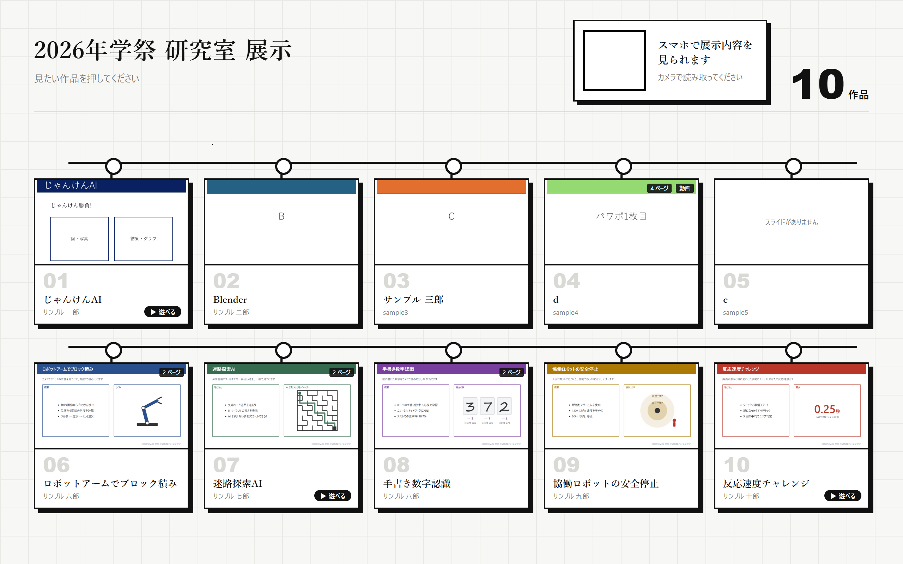

# 展示ランチャー

来場者がスライドを見たり、作品(exe)で遊んだりできる展示用ランチャー



## 必要なもの

| もの | 必須か | 説明 |
| --- | --- | --- |
| Windows | 必須 | exe の起動・パワポの変換に使う |
| [Node.js](https://nodejs.org) 18 以上 | 必須 | サーバーを動かす(追加パッケージは不要) |
| Microsoft Edge | 本番のみ | `start.bat` が全画面で開く |
| Microsoft PowerPoint | なくても可 | パワポを画像に変換するのに使う。なければ画像(PNG)で提出してもらう |

## 入っているもの

| ファイル | 役割 |
| --- | --- |
| `start.bat` | 本番用。ダブルクリックでサーバーと全画面ブラウザが起動 |
| `server.js` | サーバー。提出フォルダを読む・exe を起動/終了する |
| `public/index.html` | 画面の骨組み(一覧・スライド表示・起動中画面) |
| `public/style.css` | 画面の見た目 |
| `public/app.js` | 画面の動き(キー操作・スライド送り・exe の起動など) |
| `launch.ps1` | exe を起動して、画面を一番手前に出す補助 |
| `convert-pptx.ps1` | パワポを画像に変換する補助(PowerPoint が必要) |
| `cache/` | パワポを変換した画像の置き場(自動で作られる。消しても再変換される) |
| `config.json` | 設定(タイトル、提出フォルダの場所、時間) |
| `exhibits/` | 提出フォルダ(サンプル作品入り) |

### サンプル作品について

`exhibits/` のサンプルは、スライド画像・パワポ・`info.txt` だけ入っています。
exe・動画・QR コードはリポジトリに含めていない(`.gitignore` で除外)ので、次のようになります。

- ゲームのサンプル(じゃんけん・迷路・反応速度)は、exe がないので「遊ぶ」ボタンが出ません。迷路と反応速度は `game/` に C# のソース(`.cs`)があるので、ビルドして exe を置けば遊べます。
- 動画・QR コードを試したいときは、自分で `.mp4` や `QRコード.png` を置いてください。

## 試しに動かす(開発中)

```
git clone https://github.com/taiki0709/gakusai-exhibit-launcher
cd gakusai
node server.js
```

ブラウザで `http://localhost:3000` を開きます。止めるときは `Ctrl` + `C`。

(エクスプローラーからなら、このフォルダのアドレス欄に `cmd` と入力して Enter → `node server.js`)

## 本番(展示当日)

`start.bat` をダブルクリック。Edge が画面いっぱいで開きます。
全画面を閉じるときは `Alt` + `F4`。

## 作品の入れ方

`exhibits` の中に、1作品1フォルダで入れます。フォルダ名は `名前_タイトル` にします(`info.txt` がないときは、これが名前とタイトルになります)。

```
exhibits/
  QRコード.png      ← スマホ閲覧用の QR コード(名前に「QR」を含む画像。タイトルの右側に表示)
  太郎_展示/
    slides.pptx   ← パワポ(全ページ表示。PowerPoint が入った PC で自動変換)
    slide.png     ← 画像でも可。複数あれば順番にページになる
    demo.mp4      ← 動画(「動画を再生」ボタンを押すと再生)
    info.txt      ← なくても可
    game/         ← 遊べる作品だけ。exe と必要なファイル一式
      play.exe
```

提出フォルダの直下(作品フォルダの外)に、名前に `QR` を含む画像(`QRコード.png` など)を置くと、一覧画面のタイトルの右側に「スマホで展示内容を見られます」として表示します。来場者はこれを読み取って Google Drive の展示資料を開けます。置かなければ表示しません。

置けるもの:

| 種類 | 拡張子 | 表示のされ方 |
| --- | --- | --- |
| パワポ | .pptx / .ppt | 全スライドをページとして表示(非表示スライドは除く) |
| 画像 | .png / .jpg / .jpeg | 1枚1ページ。`slide.png` が先頭、ほかは名前順 |
| 動画 | .mp4 / .webm | 「▶ 動画を再生」ボタンを押したときに再生。終わるとスライドに戻る(複数あれば名前順に続けて再生) |

- どの作品にも、パワポか画像を1つ入れてください(一覧のカードやページになります)。
- パワポがある場合は、同じフォルダの画像よりパワポを優先して表示します。
- パワポは初めて表示したときに画像へ変換します(1作品数秒〜数十秒)。変換中のカードには「スライドを準備中です」と出ます。展示前日に一度ランチャーを起動しておくと、当日は待ち時間なしで表示できます。
- パワポを差し替えると、自動で変換し直します。
- 展示用 PC に PowerPoint が入っていない場合、パワポは表示できません。その場合は画像(PNG)で出してもらってください。
- 動画の再生中は、放置しても一覧に戻りません(終わってから数え始めます)。
- 動画は H.264 形式の mp4(スマホや多くのソフトで書き出す普通の mp4)にしてください。

`info.txt` の書き方(メモ帳で作成、1行ずつ):

```
こいこいAI
太郎
花札を打つAIと対戦できます
exe: game/play.exe
```

- 1行目タイトル、2行目名前、3行目以降は紹介文(複数行あればつなげて表示)。
- **空行は飛ばして数えます。** 1行目を空けても「タイトルなし」にはならず、次の行がタイトルになります。
- `exe:` の行は、exe が複数ある場合だけ書きます。書かなければ、作品フォルダの中(3階層まで)で最初に見つかった exe を起動します(`unins〜.exe` や `UnityCrashHandler` などの付属 exe は除く)。

## 設定 (config.json)

| 項目 | 意味 | 初期値 |
| --- | --- | --- |
| `title` | 画面の一番上の名前 | 展示ランチャー |
| `exhibitsDir` | 提出フォルダの場所 | exhibits |
| `idleSeconds` | 何秒放置したら一覧に戻るか | 90 |
| `maxPlayMinutes` | 1回に遊べる最大時間(過ぎると自動終了) | 10 |
| `port` | アドレスの番号 | 3000 |

初期値は `config.json` に書かなかったときの値です。

## 操作

| 操作 | キー |
| --- | --- |
| 作品を選ぶ | 矢印キー / マウス |
| 開く・遊ぶ | Enter / クリック |
| 前後のページ・作品 | ← → / PageUp PageDown / スライドをクリック(最後のページの次は隣の作品へ) |
| 動画を再生・閉じる | 「動画を再生」ボタン(Enter / クリック) |
| 一覧に戻る | Esc / Backspace(動画の再生中はスライドに戻る) |
| **非常停止(係の人)** | `Ctrl` + `Shift` + `Q`(ランチャー画面で押す) |

ゲームが固まったら: `Alt` + `Tab` でランチャーに切り替えて `Ctrl` + `Shift` + `Q`。

## ライセンス

[MIT License](LICENSE)
